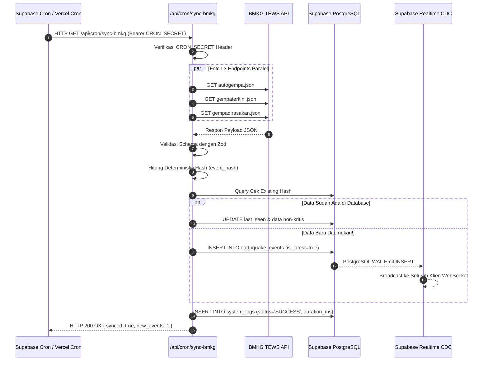

# Arsitektur Backend (Backend Architecture)

## 1. Desain Arsitektur Serverless
Arsitektur backend dibangun di atas model **Serverless Function & Managed Database Backend-as-a-Service (BaaS)** menggunakan Next.js Route Handlers dan Supabase.

Pendekatan ini dipilih karena:
- Mengeliminasi biaya dan kompleksitas pemeliharaan VM/server terpisah (seperti VPS Nginx + PM2).
- Memiliki *cold start* yang sangat rendah pada Vercel Edge/Serverless.
- Secara native terintegrasi dengan ekosistem TypeScript Next.js untuk berbagi skema tipe data antara backend dan frontend (*Type-Safety*).

---

## 2. Struktur Endpoint Backend (Route Handlers)

```text
app/api/
├── cron/
│   └── sync-bmkg/
│       └── route.ts          # Endpoint terproteksi cron untuk polling data BMKG
├── earthquakes/
│   ├── route.ts              # GET: Daftar gempa dengan pagination & filter magnitudo
│   └── latest/
│       └── route.ts          # GET: Ringkasan gempa bumi terkini
├── simulation/
│   └── route.ts              # POST: Trigger skenario simulasi (Admin Only)
│                             # DELETE: Hentikan simulasi aktif (Admin Only)
├── health/
│   └── route.ts              # GET: Cek status konektivitas sistem & BMKG
└── share/
    └── [id]/
        └── og-image/
            └── route.tsx     # GET: Generate OpenGraph Card dinamis untuk media sosial
```

---

## 3. Worker Sinkronisasi Data BMKG (Sync Engine)

Worker sinkronisasi bertanggung jawab menjaga data lokal tetap up-to-date dengan BMKG secara terpusat.



---

## 4. Keamanan & Proteksi Endpoint Cron
Endpoint `/api/cron/sync-bmkg` diproteksi menggunakan **Shared Bearer Secret Token**:
- Header: `Authorization: Bearer <CRON_SECRET_KEY>`.
- Jika request datang tanpa header ini (misal diakses publik dari browser sembarangan), server langsung merespons `HTTP 401 Unauthorized`.
- Hal ini mencegah eksploitasi serangan DoS atau pemanggilan berlebihan terhadap server BMKG dari pihak ketiga yang tidak bertanggung jawab.
