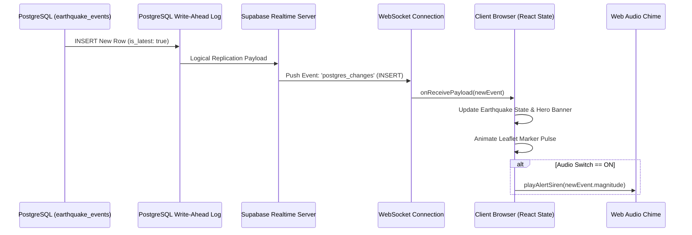
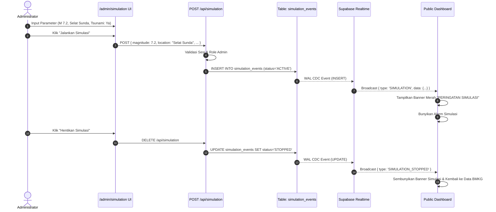

# Alur Data Sistem (Data Flow Specifications)

Dokumen ini memetakan secara detail alur data pada 4 skenario operasional utama sistem.

---

## 1. Alur Sinkronisasi Data Masuk (Ingestion Flow)

1. **Pemicu**: Penjadwal cron memanggil `/api/cron/sync-bmkg` setiap 60 detik.
2. **Pengambilan Data**: Backend mengirimkan GET request ke:
   - `autogempa.json` (1 objek data gempa terbaru).
   - `gempaterkini.json` (array 15 objek gempa $M \ge 5.0$).
   - `gempadirasakan.json` (array 15 objek gempa dirasakan).
3. **Transformasi & Normalisasi**:
   - Pemisahan string koordinat (contoh: `"-8.27,120.63"` dipecah menjadi float `latitude: -8.27`, `longitude: 120.63`).
   - Normalisasi angka magnitudo (string `"4.2"` menjadi float `4.2`).
   - Ekstraksi angka kedalaman (string `"10 km"` menjadi integer `10`).
   - Konversi format waktu ke `TIMESTAMPTZ` ISO 8601 UTC.
   - Pembangunan URL absolut Shakemap jika field tersedia: `https://data.bmkg.go.id/DataMKG/TEWS/` + `Shakemap`.
4. **Pencegahan Duplikasi**:
   - Membentuk `event_hash = md5(DateTime + latitude + longitude + magnitude)`.
   - Melakukan `UPSERT` pada tabel `earthquake_events` dengan basis kolom `event_hash`.
5. **Logging**:
   - Mencatat waktu selesai dan jumlah baris baru ke tabel `system_logs`.

---

## 2. Alur Siaran Peringatan Realtime (Realtime Broadcast Flow)

---

## 3. Alur Eksekusi Simulasi Terisolasi (Simulation Flow)

Untuk menjaga integritas data ilmiah, alur eksekusi simulasi dipisahkan secara fisik di tingkat basis data:

---

## 4. Alur Permintaan Detail & Shareable Card

1. Pengguna membuka URL `/earthquake/[id]` atau mengklik kartu gempa di dashboard.
2. Server Component memuat data gempa spesifik dari tabel `earthquake_events` berdasarkan ID unik.
3. Metadata OpenGraph (`og:title`, `og:description`, `og:image`) dirender di server:
   - URL gambar OG merujuk ke endpoint dinamis `/api/share/[id]/og-image`.
   - Endpoint menghasilkan gambar kartu darurat otomatis berisi magnitudo, waktu kejadian, peta mini, dan logo resmi BMKG.
4. Saat dibagikan ke WhatsApp, Twitter, atau Facebook, kartu pratinjau muncul secara instan dan rapi.
