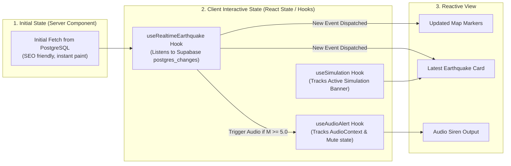

# Arsitektur Frontend (Frontend Architecture)

## 1. Pola & Paradigma Frontend
Frontend dirancang menggunakan **Next.js App Router** dengan pendekatan arsitektur komponen modular, *declarative state management*, dan pemisahan tegas antara Server Components (RSC) dan Client Components (`"use client"`).

---

## 2. Struktur Komponen UI (Component Tree)

```text
app/
├── layout.tsx                    # Root Layout: Theme, Font, Toast Provider, Auth Context
├── page.tsx                      # Dashboard Utama (Server Component Data Fetching)
├── earthquake/
│   └── [id]/page.tsx             # Detail Kejadian Gempa & Kartu Shareable
├── admin/
│   ├── layout.tsx                # Admin Guard Layout (Server Session & Allowlist Check)
│   ├── simulation/page.tsx       # Konsol Kontrol Skenario Simulasi
│   └── logs/page.tsx             # Audit Log Sinkronisasi Sistem
└── components/
    ├── navbar.tsx                # Navigasi, Badge Status BMKG, Toggle Suara, Login Button
    ├── earthquake-hero.tsx       # Kartu Sorotan Gempa Terkini + Shakemap Lightbox
    ├── earthquake-map.tsx        # Dynamic Leaflet GIS Map (Client-only / no SSR)
    ├── earthquake-list.tsx       # Tabel & Tab Riwayat (M 5.0+ dan Gempa Dirasakan)
    ├── alert-banner.tsx          # Banner Peringatan Darurat (Aktual & Simulasi)
    ├── audio-controller.tsx      # Manajemen Web Audio API, unlock autoplay, mute toggle
    ├── notification-drawer.tsx   # Pusat Notifikasi & Log Peringatan Sesi
    └── ui/                       # Komponen Desain Sistem shadcn/ui (Button, Dialog, Badge, Tabs)
```

---

## 3. Manajemen State & Sinkronisasi Realtime

Frontend mengelola 3 lapisan state:



### Penanganan Khusus Leaflet di Next.js (SSR Window Issue)
Leaflet mengakses objek global browser `window` dan `document` pada saat inisialisasi file library. Untuk mencegah error kompilasi Next.js (`window is not defined`), komponen peta wajib diimpor secara dinamis dengan opsi SSR dinonaktifkan:

```tsx
// Contoh implementasi di components/earthquake-map-wrapper.tsx
import dynamic from 'next/dynamic';

export const EarthquakeMap = dynamic(
  () => import('./earthquake-map').then((mod) => mod.EarthquakeMapInner),
  { 
    ssr: false,
    loading: () => <div className="h-[450px] w-full animate-pulse bg-muted rounded-xl flex items-center justify-center">Memuat Peta Seismik...</div>
  }
);
```

---

## 4. Audio Alert Manager & Kebijakan Autoplay Browser
Browser modern memblokir eksekusi `Audio.play()` jika belum ada interaksi pengguna (*gesture*).

**Strategi Penanganan Autoplay**:
1. Saat halaman dimuat, tombol audio berstatus `[ Suara: Nonaktif ]` dengan icon speaker dicoret.
2. Pengguna mengklik tombol switch "Aktifkan Sirine".
3. Handler klik langsung memanggil:
   ```ts
   const audioCtx = new (window.AudioContext || window.webkitAudioContext)();
   if (audioCtx.state === 'suspended') {
     await audioCtx.resume();
   }
   // Memutar suara chime 50ms sangat lembut sebagai konfirmasi aktivasi
   playUnlockSound();
   ```
4. State `isAudioUnlocked = true` disimpan di `localStorage`.
5. Setiap ada event gempa baru di kanal WebSocket, fungsi pemutar audio dapat beroperasi secara instan tanpa diblokir oleh browser.
