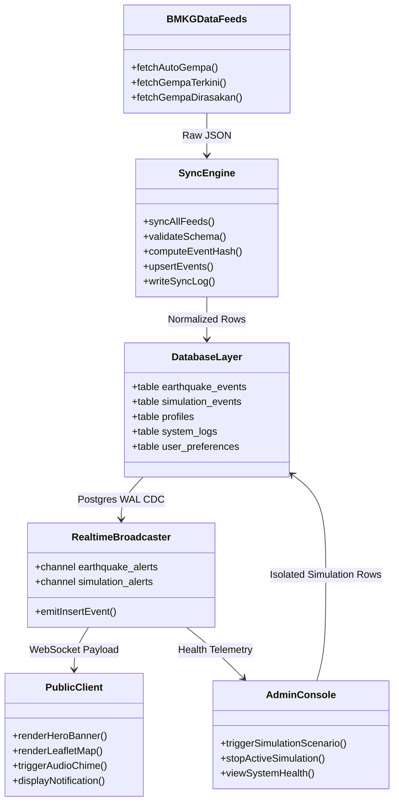
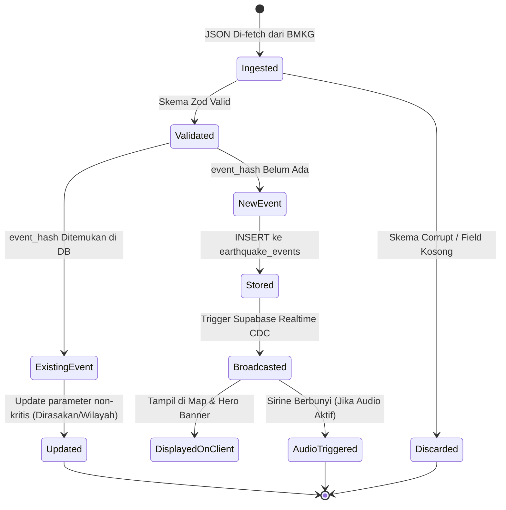
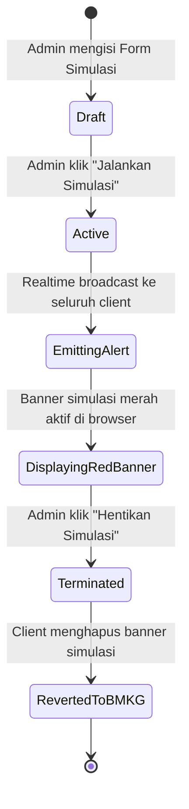

# Diagram Sistem (System Architecture Diagrams)

Koleksi diagram visual Mermaid yang memetakan keterhubungan modul, status siklus hidup data, dan model arsitektur sistem.

---

## 1. Diagram Komponen Modular (Component Diagram)

---

## 2. Diagram Status Kejadian Gempa (State Diagram)

Diagram status siklus hidup kejadian gempa di dalam sistem:

---

## 3. Diagram Status Skenario Simulasi (Simulation State Diagram)

