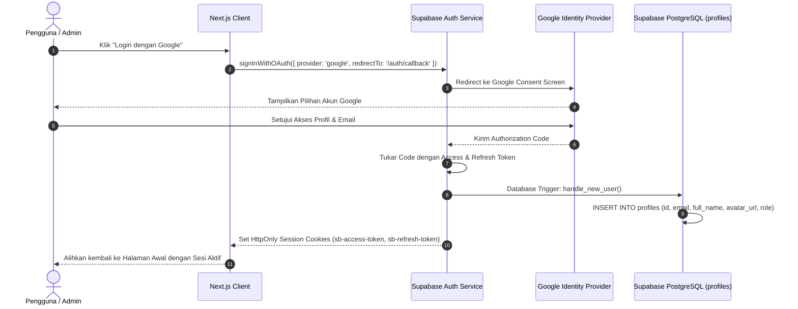

# Autentikasi & Otorisasi (Authentication & Authorization)

Dokumen ini merinci arsitektur autentikasi berbasis Google OAuth menggunakan Supabase Auth serta mekanisme otorisasi berbasis peran (Role-Based Access Control / RBAC) dengan proteksi server-side allowlist.

---

## 1. Alur Autentikasi Google OAuth



---

## 2. Trigger Sinkronisasi Profil Otomatis (Postgres Function)

Ketika pengguna baru pertama kali login melalui Google OAuth, data dari tabel `auth.users` secara otomatis direplikasi ke tabel publik `public.profiles`:

```sql
-- Function trigger untuk menyalin data profil
CREATE OR REPLACE FUNCTION public.handle_new_user()
RETURNS TRIGGER AS $$
DECLARE
  assigned_role TEXT := 'user';
BEGIN
  -- Cek apakah email terdaftar dalam allowlist admin di app_metadata atau default
  IF NEW.email = ANY(string_to_array(current_setting('app.admin_allowlist_emails', true), ',')) THEN
    assigned_role := 'admin';
  END IF;

  INSERT INTO public.profiles (id, email, full_name, avatar_url, role)
  VALUES (
    NEW.id,
    NEW.email,
    NEW.raw_user_meta_data->>'full_name',
    NEW.raw_user_meta_data->>'avatar_url',
    assigned_role
  )
  ON CONFLICT (id) DO UPDATE SET
    full_name = EXCLUDED.full_name,
    avatar_url = EXCLUDED.avatar_url;

  RETURN NEW;
END;
$$ LANGUAGE plpgsql SECURITY DEFINER;

-- Trigger setelah INSERT di auth.users
CREATE TRIGGER on_auth_user_created
  AFTER INSERT ON auth.users
  FOR EACH ROW EXECUTE FUNCTION public.handle_new_user();
```

---

## 3. Otorisasi Administrator (Server-Side Allowlist Protection)

Untuk menghindari celah keamanan di mana pengguna sembarangan mengklaim hak akses admin:
1. **Pemeriksaan Sisi Server (Next.js Middleware & Route Handlers)**:
   Pemeriksaan hak admin TIDAK PERNAH dilakukan hanya di sisi frontend React state.
2. **Variabel Lingkungan Allowlist**:
   ```env
   # Daftar email admin dipisahkan tanda koma
   ADMIN_ALLOWLIST_EMAILS="lead.developer@gmail.com,judge.evaluator@hackathon.id"
   ```
3. **Mekanisme Verifikasi di Next.js Server Handler**:
   ```ts
   // lib/auth/admin-guard.ts
   import { createServerClient } from '@supabase/ssr';
   import { cookies } from 'next/headers';

   export async function verifyAdmin() {
     const cookieStore = cookies();
     const supabase = createServerClient(/* ... */);
     
     const { data: { user } } = await supabase.auth.getUser();
     if (!user || !user.email) {
       return { isAdmin: false, error: 'UNAUTHORIZED' };
     }

     const allowlist = (process.env.ADMIN_ALLOWLIST_EMAILS || '')
       .split(',')
       .map((e) => e.trim().toLowerCase());

     const isAllowed = allowlist.includes(user.email.toLowerCase());
     return { isAdmin: isAllowed, user };
   }
   ```
4. **Proteksi Halaman `/admin/*`**:
   Jika `isAdmin === false`, sistem langsung me-redirect pengguna ke halaman utama (`/`) dengan status kode 403 (*Forbidden*).
