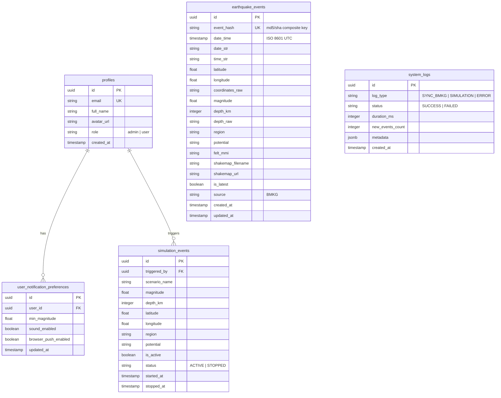

# Desain Skema Basis Data & ERD (Database Schema)

## 1. Entity Relationship Diagram (ERD)



---

## 2. Definisi Struktur Tabel PostgreSQL (DDL)

```sql
-- 1. Enable UUID Extension
CREATE EXTENSION IF NOT EXISTS "uuid-ossp";

-- 2. TABEL PROFILES (Tersinkronisasi otomatis dengan auth.users)
CREATE TABLE public.profiles (
    id UUID PRIMARY KEY REFERENCES auth.users(id) ON DELETE CASCADE,
    email TEXT UNIQUE NOT NULL,
    full_name TEXT,
    avatar_url TEXT,
    role TEXT NOT NULL DEFAULT 'user' CHECK (role IN ('admin', 'user')),
    created_at TIMESTAMPTZ NOT NULL DEFAULT timezone('utc'::text, now())
);

-- 3. TABEL EARTHQUAKE_EVENTS (DATA RESMI BMKG)
CREATE TABLE public.earthquake_events (
    id UUID PRIMARY KEY DEFAULT uuid_generate_v4(),
    event_hash TEXT UNIQUE NOT NULL, -- Kunci deterministik pencegah duplikasi
    date_time TIMESTAMPTZ NOT NULL,
    date_str TEXT NOT NULL,          -- e.g. "03 Nov 2026"
    time_str TEXT NOT NULL,          -- e.g. "18:43:49 WIB"
    latitude NUMERIC(6, 3) NOT NULL,
    longitude NUMERIC(6, 3) NOT NULL,
    coordinates_raw TEXT NOT NULL,   -- e.g. "-8.27,120.63"
    magnitude NUMERIC(3, 1) NOT NULL,
    depth_km INTEGER NOT NULL,
    depth_raw TEXT NOT NULL,         -- e.g. "10 km"
    region TEXT NOT NULL,
    potential TEXT,                  -- e.g. "Tidak berpotensi tsunami"
    felt_mmi TEXT,                   -- e.g. "II - III Kab. Nagekeo"
    shakemap_filename TEXT,          -- e.g. "20261103184349.mmi.jpg"
    shakemap_url TEXT,
    is_latest BOOLEAN NOT NULL DEFAULT false,
    source TEXT NOT NULL DEFAULT 'BMKG',
    created_at TIMESTAMPTZ NOT NULL DEFAULT timezone('utc'::text, now()),
    updated_at TIMESTAMPTZ NOT NULL DEFAULT timezone('utc'::text, now())
);

-- Indexing untuk query cepat
CREATE INDEX idx_earthquake_date_time ON public.earthquake_events(date_time DESC);
CREATE INDEX idx_earthquake_magnitude ON public.earthquake_events(magnitude DESC);
CREATE INDEX idx_earthquake_is_latest ON public.earthquake_events(is_latest) WHERE is_latest = true;

-- 4. TABEL SIMULATION_EVENTS (TERISOLASI DARI DATA BMKG)
CREATE TABLE public.simulation_events (
    id UUID PRIMARY KEY DEFAULT uuid_generate_v4(),
    triggered_by UUID REFERENCES public.profiles(id) ON DELETE SET NULL,
    scenario_name TEXT NOT NULL DEFAULT 'Demo Gempa Hackathon',
    magnitude NUMERIC(3, 1) NOT NULL,
    depth_km INTEGER NOT NULL,
    latitude NUMERIC(6, 3) NOT NULL,
    longitude NUMERIC(6, 3) NOT NULL,
    region TEXT NOT NULL,
    potential TEXT NOT NULL DEFAULT 'Berpotensi Tsunami',
    is_active BOOLEAN NOT NULL DEFAULT true,
    status TEXT NOT NULL DEFAULT 'ACTIVE' CHECK (status IN ('ACTIVE', 'STOPPED')),
    started_at TIMESTAMPTZ NOT NULL DEFAULT timezone('utc'::text, now()),
    stopped_at TIMESTAMPTZ
);

CREATE INDEX idx_simulation_active ON public.simulation_events(is_active) WHERE is_active = true;

-- 5. TABEL SYSTEM_LOGS (AUDIT TRAIL SINKRONISASI BMKG)
CREATE TABLE public.system_logs (
    id UUID PRIMARY KEY DEFAULT uuid_generate_v4(),
    log_type TEXT NOT NULL DEFAULT 'SYNC_BMKG',
    status TEXT NOT NULL CHECK (status IN ('SUCCESS', 'FAILED')),
    duration_ms INTEGER,
    new_events_count INTEGER DEFAULT 0,
    metadata JSONB,
    created_at TIMESTAMPTZ NOT NULL DEFAULT timezone('utc'::text, now())
);

CREATE INDEX idx_logs_created_at ON public.system_logs(created_at DESC);

-- 6. TABEL USER_NOTIFICATION_PREFERENCES
CREATE TABLE public.user_notification_preferences (
    id UUID PRIMARY KEY DEFAULT uuid_generate_v4(),
    user_id UUID UNIQUE NOT NULL REFERENCES public.profiles(id) ON DELETE CASCADE,
    min_magnitude NUMERIC(3, 1) NOT NULL DEFAULT 5.0,
    sound_enabled BOOLEAN NOT NULL DEFAULT true,
    browser_push_enabled BOOLEAN NOT NULL DEFAULT false,
    updated_at TIMESTAMPTZ NOT NULL DEFAULT timezone('utc'::text, now())
);
```

---

## 3. Kebijakan Row Level Security (RLS)

```sql
-- Enable RLS di semua tabel
ALTER TABLE public.profiles ENABLE ROW LEVEL SECURITY;
ALTER TABLE public.earthquake_events ENABLE ROW LEVEL SECURITY;
ALTER TABLE public.simulation_events ENABLE ROW LEVEL SECURITY;
ALTER TABLE public.system_logs ENABLE ROW LEVEL SECURITY;
ALTER TABLE public.user_notification_preferences ENABLE ROW LEVEL SECURITY;

-- 1. Profiles: Semua bisa membaca, pengguna hanya bisa mengedit profil sendiri
CREATE POLICY "Public profiles are viewable by everyone" 
ON public.profiles FOR SELECT USING (true);

CREATE POLICY "Users can update own profile" 
ON public.profiles FOR UPDATE USING (auth.uid() = id);

-- 2. Earthquake Events (DATA BMKG): Read-only untuk umum, mutasi HANYA lewat service_role
CREATE POLICY "Earthquake events are viewable by everyone" 
ON public.earthquake_events FOR SELECT USING (true);

-- TIDAK ADA POLICY INSERT/UPDATE untuk 'anon' atau 'authenticated'!
-- Hanya service_role yang bypass RLS yang dapat melakukan INSERT/UPDATE.

-- 3. Simulation Events: Terbuka untuk dibaca (agar public dashboard bisa menampilkan peringatan simulasi)
CREATE POLICY "Simulation events are viewable by everyone" 
ON public.simulation_events FOR SELECT USING (true);

-- Hanya admin yang dapat membuat / menghentikan simulasi
CREATE POLICY "Only admins can insert simulations" 
ON public.simulation_events FOR INSERT 
WITH CHECK (
  EXISTS (
    SELECT 1 FROM public.profiles 
    WHERE profiles.id = auth.uid() AND profiles.role = 'admin'
  )
);

CREATE POLICY "Only admins can update simulations" 
ON public.simulation_events FOR UPDATE 
USING (
  EXISTS (
    SELECT 1 FROM public.profiles 
    WHERE profiles.id = auth.uid() AND profiles.role = 'admin'
  )
);

-- 4. Enable Supabase Realtime Publication
ALTER PUBLICATION supabase_realtime ADD TABLE public.earthquake_events;
ALTER PUBLICATION supabase_realtime ADD TABLE public.simulation_events;
```
