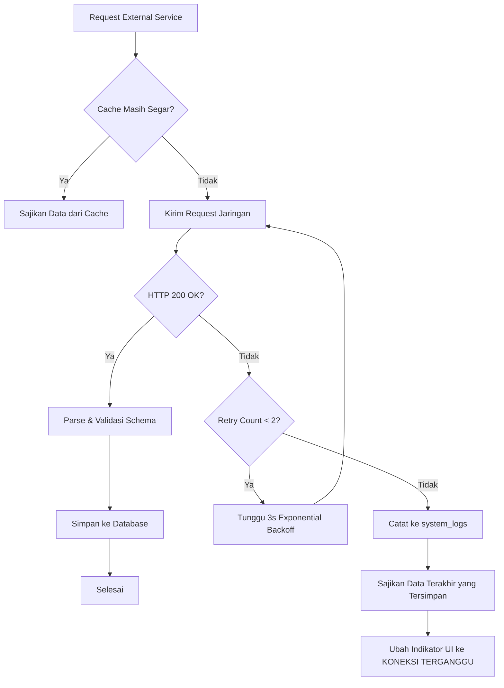

# Gambaran Umum Integrasi Eksternal (Integrations Overview)

Platform ini mengandalkan integrasi dengan sejumlah penyedia layanan eksternal untuk memperoleh data seismik, menyediakan autentikasi, merender tile peta geografis, dan menyiarkan event data.

---

## 1. Daftar Layanan Eksternal

| Nama Layanan | Kategori / Tujuan | Mekanisme Komunikasi | Status Kesiapan Kredensial |
| :--- | :--- | :--- | :--- |
| **BMKG TEWS Open Data** | Sumber data resmi kejadian gempa bumi Indonesia | HTTP GET (JSON via Cloudflare CDN) | ✅ Publik, tanpa API key. Memerlukan header `User-Agent`. |
| **Supabase Database & Realtime** | Penyimpanan transaksional & WebSocket broadcasting | PostgreSQL Wire Protocol + Supabase JS Client | ⚠️ Memerlukan Project URL & Service Role Key di `.env`. |
| **Google Cloud Identity (OAuth)** | Autentikasi pengguna & verifikasi login admin | OAuth 2.0 Authorization Code Flow | ⚠️ Memerlukan Google OAuth Client ID & Secret di Supabase Console. |
| **OpenStreetMap (Tile Servers)** | Peta visual interaktif kepulauan Indonesia | HTTP GET Raster Tiles (`/{z}/{x}/{y}.png`) | ✅ Publik, gratis, open-source tanpa kunci API. |
| **Vercel Cron / Supabase Cron** | Penjadwalan polling otomatis setiap 60 detik | HTTP GET Webhook / `pg_net` SQL extension | ⚠️ Memerlukan konfigurasi `CRON_SECRET` di `.env`. |

---

## 2. Pola Penanganan Kegagalan Layanan (Fault-Tolerance Pattern)

- **Graceful Fallback**: Kegagalan pada layanan eksternal (BMKG / Tile Server) tidak boleh menyebabkan website crash (HTTP 500) kepada pengguna.
- **Fail-Open Strategy untuk Pengguna**: Jika sistem autentikasi Google mengalami gangguan, pengguna umum tetap dapat membaca dashboard data darurat gempa bumi secara penuh.
