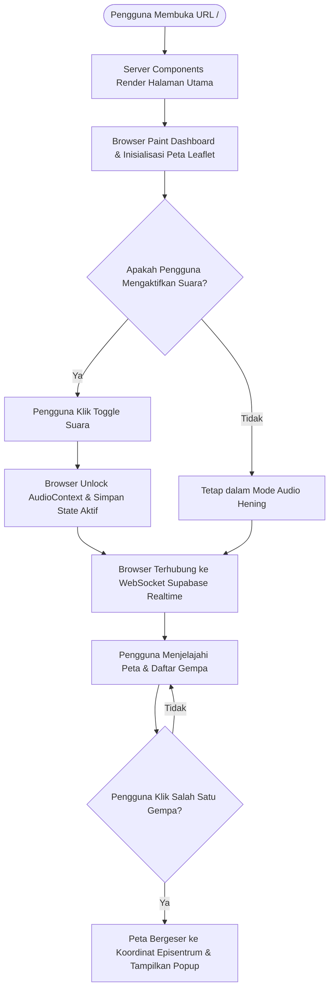
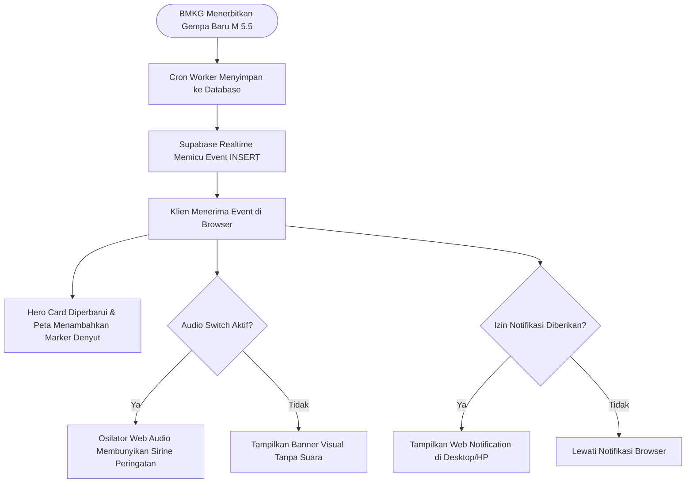
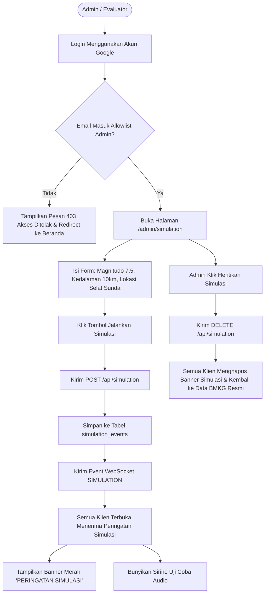

# Alur Pengguna (User Flows)

Kumpulan diagram alur interaksi pengguna (User Flows) untuk skenario utama sistem: pengunjung publik, penerimaan gempa baru, dan demonstrasi simulasi oleh administrator.

---

## 1. Alur Pengunjung Publik (Public Visitor Flow)

---

## 2. Alur Penerimaan Data Gempa Baru (Incoming Earthquake Event Flow)

---

## 3. Alur Demonstrasi Simulasi Administrator (Admin Simulation Demo Flow)

